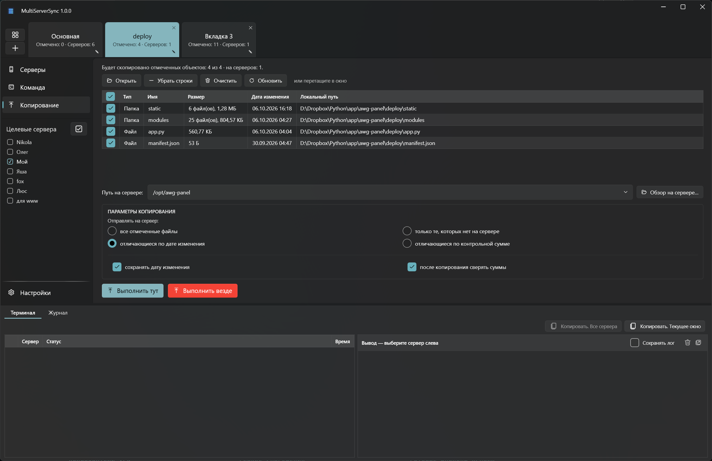
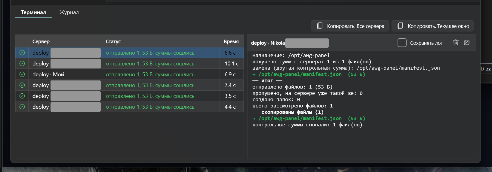
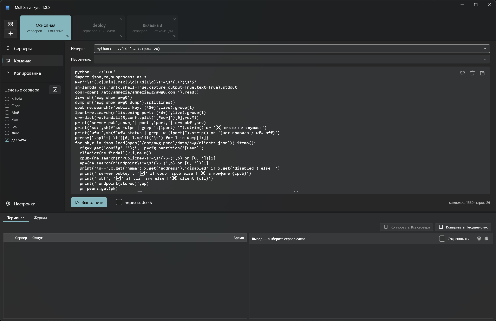
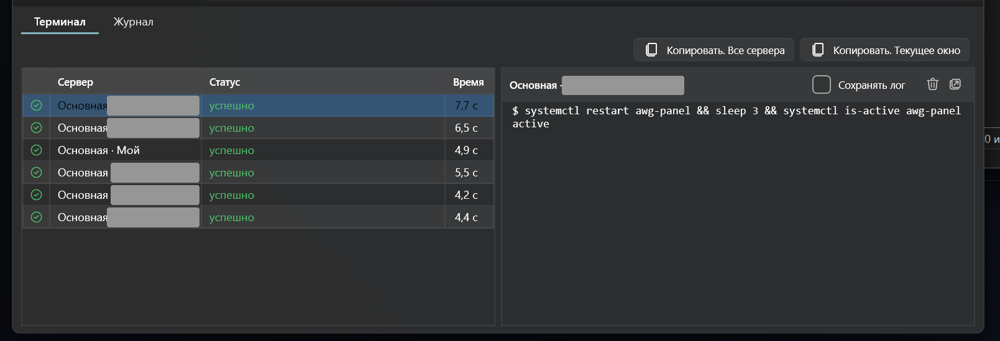
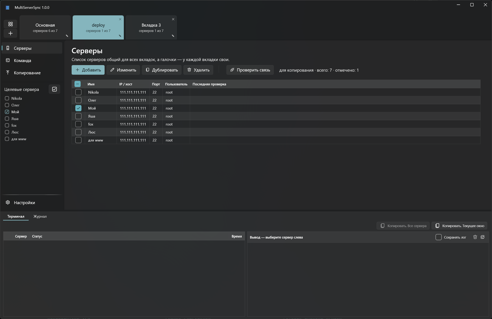
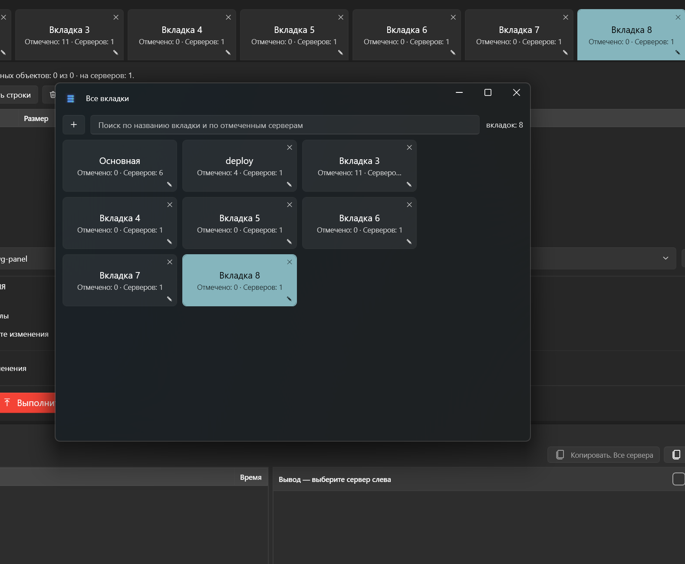

<div align="center">


# MultiServerSync

**Файлы и команды на все серверы сразу.**

Отмечаете серверы — и одной кнопкой заливаете файлы или выполняете команду на всех. Каждый сервер отчитывается отдельно.

[](https://byfox.dev/data/multiserversync/multiserversync.zip)
[](https://byfox.dev/multiserversync/)


[](LICENSE)

[English](README.md) · **Русский**

</div>

<p align="center">
<a href="images/multiserversync-copy.png"></a>
<a href="images/multiserversync-copy-output.png"></a>
<a href="images/multiserversync-command.png"></a>
<a href="images/multiserversync-command-output.png"></a>
<a href="images/multiserversync-servers.png"></a>
<a href="images/multiserversync-tabs.png"></a>
</p>

## Для чего

- **Сотни маршрутов — одно нажатие.** Вкладка — это сценарий: «эта папка → сюда на эти серверы», «тот файл → туда». **Выполнить везде** запускает все вкладки разом.
- **Скопировал — и сразу команды.** Свитч на вкладке копирования: после удачной заливки выполняются её команды — только на тех серверах, где копирование прошло.
- **Команды параллельно.** Командные вкладки работают одновременно — даже разные команды на одном сервере: в одной логи, в другой перезапуск.
- **Быстрое копирование со сверкой.** SHA-256 до отправки — совпавшее не едет; после — подтверждение, что всё доехало целым.
- **Не тот сервер — не пройдёт.** Умный режим помнит, куда обычно идёт каждая команда и вкладка, и спрашивает перед непривычным сервером.

Серверы заводятся один раз. Дальше — отметили нужные, выбрали файлы или набрали команду и нажали **Выполнить**.

- **Копирование на все серверы** — файлы и папки уходят на отмеченные серверы параллельно. Обрыв связи не оставит обрезка — файл подменяется целиком. Упавшие серверы повторяются одной кнопкой.
- **Много потоков** — мелочь едет сжатыми tar-пачками в три потока, крупные файлы — кусками в четыре подключения. rsync на сервере не нужен.
- **Только изменённое** — сверка по дате или по SHA-256: совпавшие файлы не отправляются. После копирования суммы можно сверить ещё раз.
- **Права, владелец и дата на месте** — заменённый файл сохраняет права и владельца, новый берёт их у папки, в которую ложится.
- **Скачивание** — с серверов на компьютер тем же способом: только изменённое, сверка сумм; с нескольких серверов — каждый в свою подпапку. Размер и дата в списке сами подтягиваются с серверов.
- **Проводник** — две большие панели, компьютер и сервер, как в WinSCP: Enter, F2, F5 — копировать, Del, а можно перетащить мышью между панелями и в проводник Windows; вкладок сколько угодно. Создание, переименование, удаление, копирование и перенос видны сразу, как на компьютере, сервер работает в фоне: строки, которыми он ещё занят, приглушены, действия с одной папкой идут по очереди, а вход в ещё создаваемую папку просто ждёт её; удаление подтверждается Enter. Права и владельца меняет только окно «Свойства». Файл с сервера открывается в любой программе и после сохранения уходит обратно. Маска прячет и файлы, и папки; имя и адрес сервера — прямо над его панелью.
- **Правка на месте** — конфиги и скрипты открываются во встроенном редакторе с номерами строк, подсветкой, поиском и заменой. Кодировка, концы строк, владелец и права остаются прежними, после сохранения файл сверяется по SHA-256.
- **Исключения** — маски вроде `node_modules` и `*.log` не уезжают ни туда, ни обратно.
- **Команды и скрипты** — несколько команд в одной вкладке идут по очереди: следующая — после удачной предыдущей. Скрипт любой длины уходит целиком через stdin, на `[Y/n]` отвечаете из программы, пароль sudo подаётся сам. Наборы команд — в избранное.
- **Вывод каждого сервера** — вживую и отдельно, с подсветкой и крупным шрифтом по лупе. Запуски с промежутком в несколько минут копятся в одном терминале, с «Сохранять лог» вкладка хранит все. Под каждым запуском — местные дата, время и за сколько выполнено. Терминал и журнал переживают перезапуск программы. Команды после копирования — каждая своей строкой: копирование, #1, #2, видны сразу со стартом копирования, у каждой свой статус и вывод. У каждой строки свой стоп: ждущая команда отменяется вместе с нижними; «Остановить» сверху — вся вкладка. В «Проводнике» копирования идут рядом и ждут друг друга, только если пути пересекаются. Ход копирования с оставшимся временем.
- **Лог там, где нужен** — по окончании вывод всех серверов или выбранного сам уходит в буфер обмена, а с CopyPass ещё и вставляется в первое поле ввода другой программы и отправляется Enter. Таблицу запусков можно вынести в отдельное окно, а программа открывается там, где вы закончили.
- **Видно, что не так** — постоянная плашка, если команды после копирования не выполнятся: вкладка пустая или серверы не те. Ошибки — по-человечески.
- **Вкладки под задачи** — у каждой вкладки свои серверы, файлы, путь и команда. **Выполнить везде** запускает все вкладки разом, итог виден на ярлыках. Редкие вкладки правым щелчком уходят в архивную ленту и работают там как прежде. Замок у целевого сервера закрепляет вкладку за ним: остальные серверы и наборы гаснут, пока замок не снят.
- **Подключение** — ключи OpenSSH и PuTTY или пароль, вход через промежуточный сервер, импорт из `~/.ssh/config`, PuTTY и WinSCP. Ключ сервера запоминается — подмену программа заметит.
- **Пароли зашифрованы** — под учётной записью Windows или мастер-паролем.
- **Умный режим** — спросит, если команду или копирование запускают не на том сервере, что обычно.

## Как начать

1. Распаковать [архив](https://byfox.dev/data/multiserversync/multiserversync.zip)
2. Запустить `MultiServerSync.exe`
3. Добавить серверы — и отметить, куда отправлять

Windows 10 / 11 (x64), нужен [.NET 9 Desktop Runtime](https://dotnet.microsoft.com/download/dotnet/9.0). Бесплатно, открытый код, без телеметрии.

## Сборка из исходников

Нужен [.NET 9 SDK](https://dotnet.microsoft.com/download/dotnet/9.0).

```powershell
git clone https://github.com/FoxUSA/MultiServerSync.git
cd MultiServerSync
powershell -ExecutionPolicy Bypass -File .\Data\build.ps1
```

Лаунчер `MultiServerSync.exe` появится в корне репозитория, программа — в `Data`, настройки — в `UserData`. Исходники: `Data/src/App` (программа, WPF + [WPF UI](https://github.com/lepoco/wpfui), [SSH.NET](https://github.com/sshnet/SSH.NET), [AvalonEdit](https://github.com/icsharpcode/AvalonEdit)) и `Data/src/Launcher`. Заметки для разработчика: [Data/README.md](Data/README.md).

## Лицензия

[GPL-3.0](LICENSE) — можно пользоваться, менять и распространять; программы на основе этого кода тоже должны оставаться открытыми.

---

<sub>Ключевые слова: SSH на много серверов, синхронизация по SFTP, заливка файлов на несколько серверов, выполнение команды на всех серверах, параллельный SSH, скачивание с нескольких серверов, двухпанельный SFTP-проводник, SSH-утилита для Windows.</sub>
